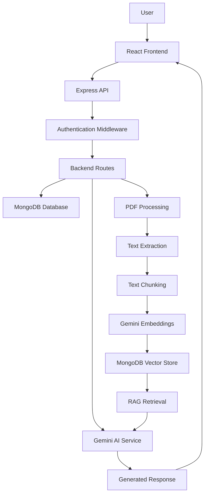

# MemoAI — AI-Powered Personal Learning Assistant

MemoAI is an AI-powered learning platform that transforms static study materials into interactive learning experiences. Users can upload PDF documents, generate concise summaries, create flashcards and quizzes, and interact with an AI assistant to understand concepts through context-aware conversations.

The platform combines a MERN-based application architecture with Generative AI and Retrieval-Augmented Generation (RAG) to make document-based learning more interactive and personalized.

## Key Features

- **PDF Document Upload:** Upload and manage study materials in PDF format.
- **AI-Powered Summarization:** Generate concise summaries from uploaded documents.
- **Automated Flashcards:** Convert document content into question-and-answer flashcards.
- **Interactive Quizzes:** Generate quizzes to evaluate understanding and reinforce learning.
- **Context-Aware AI Chat:** Ask questions about uploaded documents and receive relevant answers.
- **Concept Explanation:** Get simplified explanations of complex concepts.
- **Semantic Search:** Retrieve relevant document chunks using vector embeddings.
- **Chat History:** Access previous conversations associated with documents.
- **User Authentication:** Secure access to user-specific resources using JWT-based authentication.

## Technology Stack

| Category | Technologies |
|---|---|
| Frontend | React, JavaScript, CSS |
| Backend | Node.js, Express.js |
| Database | MongoDB, Mongoose |
| AI Integration | Google Gemini API |
| Vector Search | MongoDB Atlas Vector Search |
| Authentication | JWT, bcryptjs, HTTP-only cookies |
| File Handling | Multer |
| PDF Processing | pdf-parse-fixed, pdf-to-img |
| OCR | Tesseract.js |
| Validation | Express Validator |

## System Architecture



## How It Works

### 1. Document Upload and Processing

1. The user uploads a PDF through the React frontend.
2. The file is sent to the backend using `multipart/form-data`.
3. Multer handles the uploaded file.
4. PDF processing utilities extract the document's text.
5. The extracted content is divided into smaller chunks.
6. Document metadata and processed information are stored for subsequent operations.

### 2. AI-Powered Content Generation

MemoAI integrates the Google Gemini API to generate learning materials.

Based on the uploaded document, the backend can generate:

- Summaries of important topics.
- Question-and-answer flashcards.
- Multiple-choice quizzes.
- Simplified explanations of concepts.

### 3. Retrieval-Augmented Generation (RAG)

MemoAI uses RAG to provide document-aware responses instead of relying exclusively on the language model's general knowledge.

**RAG workflow:**

1. Convert document chunks into vector embeddings.
2. Store embeddings in MongoDB Atlas.
3. Convert the user's question into an embedding.
4. Perform semantic similarity search using MongoDB Atlas Vector Search.
5. Retrieve the most relevant document chunks.
6. Provide the retrieved context to Gemini.
7. Generate a response grounded in the retrieved document content.

The vector search configuration uses:
- Index: `autoembed_index`
- Embedding path: `chunks.embedding`
- Retrieved chunks: Top 3
- Candidate documents: 100
- Filtering: `documentId` and `userId`

This helps maintain document-specific and user-specific retrieval.

### 4. Authentication and Security

MemoAI implements authentication and protected backend routes.

- Password hashing using bcryptjs.
- JWT-based access authentication.
- Short-lived access tokens.
- Refresh tokens stored in HTTP-only cookies.
- Protected API endpoints using authentication middleware.
- User-specific document and conversation access.

## Backend API Overview

| Method | Endpoint | Description |
|---|---|---|
| POST | `/api/auth/register` | Register a user |
| POST | `/api/auth/login` | Authenticate a user |
| POST | `/api/auth/refresh` | Refresh access token |
| POST | `/api/auth/logout` | Logout |
| POST | `/api/document/upload` | Upload a PDF |
| GET | `/api/document` | Manage documents |
| POST | `/api/ai/generate-flashcards` | Generate flashcards |
| POST | `/api/ai/generate-quiz` | Generate quizzes |
| POST | `/api/ai/generate-summary` | Generate summaries |
| POST | `/api/ai/chat` | Chat with document context |
| POST | `/api/ai/explain-concept` | Explain concepts |
| GET | `/api/ai/chat-history` | Retrieve chat history |

*Refer to the backend route definitions for exact request parameters and response formats.*

## Project Structure

```text
MemoAI/
│
├── backend/
│   ├── config/
│   │   └── db.js
│   │
│   ├── controllers/
│   ├── middleware/
│   ├── models/
│   ├── routes/
│   │   ├── authRoutes.js
│   │   ├── documentRoutes.js
│   │   ├── flashcardRoutes.js
│   │   ├── aiRoutes.js
│   │   ├── quizRoutes.js
│   │   └── progressRoutes.js
│   │
│   ├── services/
│   ├── utils/
│   ├── server.js
│   └── package.json
│
├── frontend/
│   ├── src/
│   │   ├── components/
│   │   ├── pages/
│   │   ├── context/
│   │   └── ...
│   └── package.json
│
└── README.md
```

## Getting Started

### Prerequisites

- Node.js and npm
- MongoDB Atlas account
- Google Gemini API key
- Git

### 1. Clone the Repository

```bash
git clone https://github.com/Aishasingh02/MemoAI.git

cd MemoAI
```

### 2. Backend Setup

```bash
cd backend
npm install
```

Create a `.env` file inside the backend directory.

Configure the required environment variables according to the backend configuration:

```env
PORT=5000
MONGO_URI=your_mongodb_connection_string
JWT_ACCESS_SECRET=your_access_secret
GEMINI_API_KEY=your_gemini_api_key
```

Add any additional refresh-token, frontend URL, or AI configuration variables required by the source code.

### 3. Frontend Setup

Open another terminal:

```bash
cd frontend
npm install
npm run dev
```

### 4. Start the Backend

```bash
cd backend
npm run dev
```

The backend runs on the configured port, while the frontend runs using the Vite development server.

**Important:** Configure the MongoDB Atlas Vector Search index and its embedding field before using the document-based RAG functionality.

## Screenshots

Add application screenshots here to demonstrate the actual user interface.

| Feature | Screenshot |
|---|---|
| Dashboard | Add dashboard screenshot |
| Document Upload | Add upload screenshot |
| AI Summary | Add summary screenshot |
| Flashcards | Add flashcards screenshot |
| Quiz | Add quiz screenshot |
| AI Chat | Add chat screenshot |

## Future Improvements

- Support additional document formats.
- Improve document retrieval and response relevance.
- Introduce more advanced learning analytics.
- Add personalized learning recommendations.
- Implement improved flashcard review scheduling.
- Optimize document processing for large files.
- Add automated testing and production deployment.

## Learning Outcomes

The project brings together several important software engineering concepts:

- Full-stack development using the MERN stack.
- REST API design and backend architecture.
- Authentication and authorization.
- File uploads and PDF text extraction.
- Integration with Large Language Models.
- Vector embeddings and semantic search.
- Retrieval-Augmented Generation (RAG).
- Database modeling and document management.

## Author

**Aisha Singh**

B.Tech — Electronics and Communication Engineering

- GitHub: https://github.com/Aishasingh02
- LinkedIn: https://www.linkedin.com/in/aisha-singh-440887333/

---

*MemoAI — Making learning smarter through AI.*
